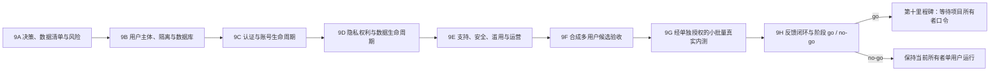

# 第九里程碑：多用户上线准备与放行门禁

> 计划状态：M9-D01–D12 已确认，9A–9E 的合成候选范围已完成；9F–9H 尚未授权。
> 9E 只完成本地合成支持、访问审计、配额、急停和运营演练，不代表政策已经专业审查或可以接收
> 真实个人数据。供应商接入、云资源创建、真实用户邀请或公开发布均未授权；具体用户、费用、
> 数据、联系渠道和邀请仍须在 9G 前单独确认。

## 1. 目标与结论

第九里程碑的目标不是立即开放注册，而是把当前“唯一所有者、单一身份、共享数据上下文”
改造成可以接受多用户安全审查的候选系统，并形成一次可复核的 `go / no-go` 放行材料。

里程碑完成时必须同时满足：

1. 每个自然人拥有稳定的内部主体，外部登录身份只作为可更换的认证凭据；
2. 所有用户数据、操作、凭据、导出、删除、审计、备份和支持访问都有明确归属；
3. 任意用户不能通过 URL、对象 ID、搜索、导出、通知、Runner、错误信息或并发竞争访问
   其他用户的数据或资源；
4. 登录、邀请、退出、会话过期、撤销、身份绑定、账号停用与恢复形成闭环；
5. 隐私告知、选择、外部发送、访问、更正、导出、删除和保留规则可以真实执行；
6. 支持、安全报告、滥用处理、事故响应、容量、费用、备份和回滚均有明确负责人和手册；
7. 9A–9F 全部硬门禁通过且项目所有者另行授权后，9G 才可邀请固定小批量真实测试用户；
8. 真实内测问题关闭或明确接受后，9H 只形成是否进入第十里程碑的阶段 `go / no-go`。

9A–9F 只允许使用合成身份和合成数据完成本地或隔离候选环境验证。9G 可以在真实身份、个人
数据、支持、费用、云端和邀请范围被再次逐项授权后开展固定小批量、仅成年人、邀请制内测；
始终不开放公开注册。9H 的 `go` 不授权公开发布、商店上架或规模扩张，第十里程碑前端变更后
还必须重跑受影响门禁。

本里程碑中的托管多用户数据不等于未来本地版的“云端保存”。第九里程碑只要求为数据归属、
导出、删除和可移植性保留兼容边界；加密云备份与多设备双向同步属于第十二里程碑的独立决定，
不得随多用户认证一起默认开启，也不得让本地离线学习依赖本里程碑的账号或云服务。

## 2. 当前基线与关键差距

当前系统除单用户私有部署能力外，已具备 9B 的合成主体/归属隔离、9C 的合成认证候选、9D
的合成隐私权利候选和 9E 的合成支持/运营控制。但这些证据不能外推为真实多用户就绪。

| 领域 | 当前事实 | 多用户前必须补齐 |
| --- | --- | --- |
| 用户主体 | 已有稳定内部用户、外部身份映射和合成账号状态机 | 真实身份供应商、退出路径和小批量邀请验收 |
| 数据归属 | 43 张用户私有表由 ORM 和 PostgreSQL RLS 候选约束 | 9F 全页面/API 隔离矩阵和真实候选数据库决定 |
| 认证 | OIDC+PKCE、MFA、邀请、会话和撤销已通过合成验证 | Clerk 数据位置、套餐、真实配置及失败/退出演练 |
| 授权 | 用户、所有者/运营和受限支持角色已建立默认拒绝；临时/紧急支持访问有范围、期限和不可变审计 | 9F 全页面/API 权限矩阵与候选栈验收 |
| 数据库 | SQLite 主线与 loopback PostgreSQL 合成迁移候选并存 | 9F 按容量、备份和恢复证据决定真实多用户数据层 |
| 凭据 | 本地 Windows 凭据管理器或云端只读文件 | 按用户隔离的凭据引用、加密存储、轮换、撤销和不回显边界 |
| 隐私 | 已有版本化候选政策、分项选择、访问/更正/全量导出及删除账本重放 | 9G 前专业审查、真实联系渠道、供应商地区和真实候选验收 |
| 支持 | 六类支持已分流，正文默认拒绝并受双确认/紧急访问边界约束 | 9G 前真实联系渠道、专业复核和真实候选验收 |
| 运营 | 已有分项急停、全站只读/停服、批量撤销、配额和 7 天最少化指标 | 9F 容量、故障注入、备份恢复和回滚综合验收 |
| 法律与地区 | 数据位于新加坡，尚无外部用户 | 用户地区、年龄、数据控制者、跨境路径、条款与隐私审查 |

SQLite 可以继续服务当前所有者单用户环境，但不推荐作为真实多用户放行的数据底座。是否采用
同机 PostgreSQL、独立实例或托管数据库必须在成本、故障域、备份和运维能力核验后决定；
计划不得把“选择 PostgreSQL”偷换为已授权购买托管数据库。

## 3. 必须先确认的决定

以下决定会改变架构、隐私、成本或支持承诺。9A 可以收集证据和比较方案，但在对应决定确认前
不得进入会锁定方案的实施阶段。

| 编号 | 决定 | 当前推荐 | 未确认时阻断 |
| --- | --- | --- | --- |
| M9-D01 | 首批用户与规模 | 邀请制、固定小批量、无公开注册；人数上限由容量测试决定 | 9B 后续容量设计、9F 放行 |
| M9-D02 | 用户地区、语言与年龄 | 首批不接收未成年人；若面向中国大陆用户，先完成新加坡数据跨境专业审查 | 隐私文本、支持范围、真实用户邀请 |
| M9-D03 | 身份供应商 | 采用受管 OIDC/OAuth，不自建密码库；供应商须核验 MFA、撤销、导出、价格和地区可用性 | 9C 认证实施 |
| M9-D04 | 数据库和托管方式 | 多用户前迁移 PostgreSQL；同机、独立或托管方案另行比较 | 9B 数据迁移、预算与灾备 |
| M9-D05 | 账号和角色模型 | 首版仅 `user`、`owner_operator`、`support_restricted`，不做团队、组织或自定义角色 | 授权矩阵与支持工具 |
| M9-D06 | 注册和邀请 | 所有账号由一次性、有期限、单用途邀请创建；不允许搜索或枚举用户 | 9C 账号生命周期 |
| M9-D07 | 功能开放范围 | AI、真实来源、邮件和高成本能力默认关闭；Runner 按用户配额且可全局急停 | 费用、滥用和容量门禁 |
| M9-D08 | 数据控制者与隐私联系 | 项目所有者先明确运营主体、联系渠道和适用地区，再由合格专业人士复核文本 | 9D 隐私与真实用户放行 |
| M9-D09 | 保留与删除 | 按数据类别确定期限；删除采用业务数据清除、最小审计墓碑和备份自然过期 | 9D 删除闭环和备份策略 |
| M9-D10 | 支持承诺 | 先承诺可兑现的支持时段和目标，不宣传 24/7 或不可保证的 SLA | 9E 支持门禁 |
| M9-D11 | 多用户预算 | 单列身份、数据库、邮件、监控、备份、带宽、Runner 和 AI 上限；禁止自动扩容/充值 | 供应商接入、候选部署 |
| M9-D12 | 内测、阶段 go 和回滚 | 9G 只做固定小批量邀请内测；9H 的 go 只允许进入第十里程碑，不是公开上线 | 9G/9H 与一切真实用户动作 |

专业隐私或法律审查属于上线输入，不应由代码检查或 AI 文字代替。审查范围至少覆盖数据位于
新加坡、目标用户所在地、跨境传输、未成年人、用户生成代码/文本、第三方身份与未来 AI
供应商。本文不声称任何法域合规认证。

## 4. 分阶段实施计划

每个阶段必须单独授权。上一阶段通过只解除下一阶段的准备门禁，不自动授权采购、部署、
真实数据迁移、真实身份接入或用户邀请。9G 和 9H 是明确例外：只有另行逐项授权后，9G 才
允许固定小批量真实内测；9H 只处理反馈和阶段决定。

### 9A：决策包、数据清单与威胁建模

目标是把所有影响方案的事实和选择补齐，不改运行系统。

- 建立逐表数据归属清单：全局受管内容、用户私有记录、共享运维记录、敏感凭据元数据、
  安全审计和可删除临时数据；
- 绘制浏览器、Web、API、数据库、Runner、备份、身份供应商、支持与未来外部 AI 的数据流；
- 建立 LINDDUN/STRIDE 风险清单，重点覆盖越权读取、IDOR、身份头伪造、账号接管、邀请泄露、
  批量导出、支持越权、Runner 滥用、日志泄漏和删除不完整；
- 比较身份、PostgreSQL、邮件、监控和备份候选方案的官方价格、数据位置、锁定风险、退出路径；
- 确认 M9-D01–D12，并记录明确不支持的用户、地区、功能和服务承诺；
- 产出版本化架构决定、数据处理清单、授权矩阵、迁移草案、测试矩阵与费用硬上限。

完成门禁：所有 D01–D12 已确认；供应商价格可核验；没有付费或远程写操作；逐表归属不存在
“未知”；项目所有者明确是否授权 9B。

### 9B：用户主体、租户隔离与数据库迁移基础

目标是让数据模型先具备不可绕过的用户归属，不接真实身份。

- 新增稳定、不可从邮箱推导的内部用户 ID；外部身份使用 `(issuer, subject)` 唯一映射，
  不以可变邮箱作为主键；
- 建立账号状态 `invited / active / suspended / deletion_pending / deleted` 及追加式状态审计；
- 将设置拆为全局策略与用户设置，禁止继续使用无归属的单例用户设置；
- 逐表补齐 `user_id`、组合唯一约束、外键和索引；全局技能包、来源目录和运行时定义不得被
  错误复制为用户数据；
- 把现有所有者记录确定性回填到唯一 owner 用户，保留原 ID、时间、事件顺序、内容锁和证据；
- 在服务层强制请求主体作用域，并在 PostgreSQL 采用行级安全或等强度的数据库侧纵深防御；
- 所有后台任务、通知、Runner 调用、导出、删除和审计事件必须显式携带用户主体；
- 完成 SQLite 到候选 PostgreSQL 的合成迁移、往返或明确回退演练；迁移失败不得覆盖原库。

完成门禁：任意缺少用户归属的业务写入失败；跨用户对象 ID 全部返回不可枚举的拒绝结果；
owner 历史迁移语义一致；迁移、备份与回滚使用合成数据通过；尚未改变 6D 真实运行库。

### 9C：认证、会话与账号生命周期

目标是把身份供应商证明转换为最小、可撤销的应用会话。

- 实现受管 OIDC Authorization Code + PKCE、精确 issuer/audience/nonce/state 校验；
- 仅使用 `HttpOnly + Secure + SameSite` 会话 Cookie，短期会话、滚动/绝对过期、服务端撤销、
  登录后会话轮换和全设备退出；前端不得存储长期 bearer token；
- MFA 由已确认身份供应商强制或可验证地继承；高风险身份绑定、删除和支持操作要求重新认证；
- 邀请令牌只保存哈希，单用途、有期限、可撤销，不在日志、URL 分析或错误信息中泄漏；
- 防止邮箱枚举、身份自动合并、错误 issuer 绑定和已删除账号复活；账号关联必须显式确认；
- 登录、邀请、回调和恢复建立独立速率限制、异常告警和安全审计；
- 明确供应商不可用、身份撤销、账号失窃和所有者锁定时的停用与恢复手册；
- 本地开发使用确定性假身份适配器，生产配置缺失时失败关闭，不能静默退回 owner 模式。

完成门禁：未认证、错误身份、错误 issuer/audience、重放、过期、撤销、CSRF、固定会话、并发
退出和账号恢复反例全部通过；任何测试凭据不进入仓库、日志、数据库或构建产物。

### 9D：隐私权利、同意与数据生命周期

目标是让隐私承诺成为可执行的产品行为，而不只是静态页面。

- 发布前准备版本化隐私告知、服务条款、可接受使用规则和供应商清单；记录版本与接受时间，
  非必要用途不得捆绑同意；
- 对身份、学习记录、代码/文本、能力证据、目标/收入、凭据引用、支持内容、日志和备份逐类
  声明目的、必要性、位置、接收方、期限和删除方式；
- 提供用户可理解的访问、更正、全量可移植导出和删除流程；导出只能包含当前用户并带版本、
  摘要、生成时间和范围说明；
- 删除采用可暂停、可确认的作业：撤销会话/凭据，清除业务正文和可关联标识，保留无敏感内容
  的最小安全/审计墓碑，并记录备份最晚自然过期时间；
- 外部 AI、来源、邮件和支持外发分别使用最少数据、明确开关和用途审计；关闭后准确展示限制；
- 对敏感财务记录、自由文本、代码和支持材料使用更严格的显示、日志和导出规则；
- 禁止支持附件默认接收身份证、合同、账单、银行材料、完整日志、数据库或凭据。

完成门禁：合成用户能完成访问、更正、导出和删除；删除后不能登录或通过旧链接恢复数据；
备份恢复不会让已删除账号重新可用；所有政策文本经项目所有者和所需专业审查确认。

### 9E：支持、滥用、安全与运营门禁

目标是确保出现账号、内容、安全或服务问题时有真实可执行的处理路径。

- 分开产品支持、账号恢复、安全漏洞、隐私请求、内容纠错与滥用申诉，定义允许字段、负责人、
  工作时段、响应目标、升级与关闭条件；
- 支持人员默认不能浏览用户正文、冒充用户或直接改数据库；临时访问必须有工单、用户可见
  原因、最小范围、期限、双重确认和不可变审计；紧急访问另行定义并事后通知；
- 提供账号暂停、邀请撤销、会话全撤销、Runner/AI/来源/邮件分项急停和全站只读/停服能力；
- 为 Runner、导出、搜索、登录、通知及未来 AI 建立每用户和全局配额、并发限制、超时、费用
  预留和拒绝语义；任何成本无法估价时停止；
- 建立最少化可观测性：使用不可逆内部主体标识关联指标，不记录学习正文、代码、token、邮箱、
  私有 URL 或支持敏感内容；
- 完成漏洞修复时限、依赖/镜像更新、密钥轮换、身份供应商故障、数据泄漏、Runner 隔离事件、
  备份失败、容量耗尽和供应商退出手册；
- 定义可兑现的可用性与支持目标、状态通知方式、维护窗口和数据事故通知流程；
- 审核安全响应头、CSP、CSRF/CORS、SSRF、XSS、注入、缓存、并发、错误信息与依赖供应链。

完成门禁：每类事件都有负责人和演练记录；支持人员无法无审计访问正文；配额与急停在合成
压力下生效；备份恢复、身份撤销和服务回滚达到已确认 RPO/RTO；预算没有未知持续费用。

### 9F：合成多用户候选验收与放行材料

目标是以多个合成身份完成真实候选栈验收，不邀请真实用户。

- 至少覆盖普通用户 A/B、已暂停用户、已删除用户、所有者/运营和受限支持身份；
- 对每个页面和 API 做读、写、列表、搜索、导出、通知、Runner、错误和并发的跨用户隔离矩阵；
- 执行认证协议反例、对象级授权、删除/恢复、备份/恢复、迁移/回滚、配额、容量、故障注入、
  桌面/移动 E2E、无障碍回归、契约漂移、密钥扫描和完整 `release-readiness`；
- 在候选环境验证公网/私网监听、TLS、身份回调、Origin、Cookie、缓存、日志、告警和急停；
- 复核供应商实际价格、资源余量、数据位置、子处理方、支持联系方式和专业审查结论；
- 形成残余风险、未开放功能、回滚点、观察指标和逐批邀请上限的 `go / no-go` 材料。

完成门禁：第 5 节进入内测前的所有硬门禁通过、没有未关闭的严重/高风险问题、没有跨用户
泄露、费用和支持能力可兑现。9F 通过只表示“可以请求 9G 真实内测授权”，不等于已上线。

### 9G：固定小批量真实用户内测

目标是验证合成环境无法证明的真实可理解性、恢复、支持和学习体验，不测试公开增长。

- 项目所有者逐项确认测试用户人数、地区、年龄、邀请名单、功能、数据位置、费用和期限；
- 只接受明确同意的成年人，通过单用途邀请加入；禁止公开链接、转邀请和搜索用户；
- 真实 AI、真实来源、邮件、社区、付费和未授权 Runner 能力继续默认关闭；
- 内测前展示隐私告知、服务/内测条款、数据位置、删除方式、支持时段和已知限制；
- 反馈默认结构化且最少化，不收集身份证明、完整日志、数据库、凭据或无关个人信息；
- 每位用户验证登录/退出/恢复、跨用户隔离、核心学习、导出、删除、支持和撤销；
- 监控容量、成本、错误、支持负荷和安全信号，但日志不得保存学习正文或代码；
- 出现跨用户泄露、账号接管、删除失效、不可估价费用或无法履行支持时立即停止邀请并回滚。

完成门禁：所有邀请可追踪和撤销；真实用户同意与反馈合法、可删除；没有严重/高风险问题；
内测数据可完整导出/删除；项目所有者明确是否进入 9H。内测参与不产生公开用户资格承诺。

### 9H：反馈闭环与阶段 go/no-go

- 将反馈分为阻断缺陷、安全/隐私、支持、可理解性、学习流程、无障碍和后续建议；
- 只把可复现事实变成改动，不把少量用户偏好冒充普遍市场结论；
- 修复后重跑受影响的隔离、认证、隐私、支持和 E2E 门禁；
- 记录未解决风险、内测用户数据处置、回滚点、成本和下一阶段限制；
- 形成 `go / conditional_go / no_go`：只决定是否允许项目所有者启动第十里程碑。

第十里程碑修改前端后必须重新验证所有受影响的第九里程碑门禁。第十一里程碑才处理中国
内地与海外公开发布、官网、App、商店和 Gitee 镜像，9H 不得提前授权这些动作。

## 5. 多用户放行硬门禁

以下任一项失败都必须判定 `no-go`，不能通过免责声明、人工小心或“用户很少”绕过：

| 门禁 | 必须证明 | 失败动作 |
| --- | --- | --- |
| 用户与范围 | 用户地区、年龄、人数、语言、功能和禁止范围已确认 | 不进入 9G |
| 认证 | 正确验证、MFA、会话轮换/撤销、邀请和恢复反例通过 | 关闭登录/邀请 |
| 数据隔离 | 所有业务对象有主体归属，跨用户矩阵无泄漏 | 停止候选，按安全事件处理 |
| 数据迁移 | owner 历史、外键、内容锁、事件顺序和回滚一致 | 保留原库，不切换 |
| 隐私 | 清单、告知、同意、导出、删除、保留和备份传播可执行 | 不收集真实个人数据 |
| 法律/地区 | 内测运营主体、联系方式、适用文本和所需专业审查完成 | 不进入 9G |
| 支持 | 渠道、负责人、账号恢复、隐私/安全/滥用分流和访问审计可用 | 不承诺服务、不邀请 |
| 安全 | 无未关闭严重/高风险问题，急停、密钥轮换和事件手册演练通过 | 修复并重新全量验收 |
| 资源与成本 | 每用户/全局配额、容量、价格、告警和硬停止已验证 | 禁用高成本能力或停止 |
| 数据保护 | 加密备份、恢复、删除后恢复语义、RPO/RTO 和异机副本通过 | 保持现有单用户状态 |
| 可观测性 | 能发现失败和滥用且日志不保存敏感正文 | 不进入真实候选 |
| 回滚 | 可撤销邀请/会话并恢复单用户版本，历史不被破坏 | 不执行切换 |
| 授权 | 项目所有者对 9G 的真实身份、数据、费用、云端变更和邀请逐项明确授权 | 默认拒绝 |

## 6. 测试与证据最低矩阵

- 单元/属性测试：主体作用域、组合唯一约束、状态机、保留期限和配额；
- API 契约测试：401/403/404 防枚举、对象级授权、幂等、重放和并发；
- 迁移测试：旧 owner 数据回填、SQLite→PostgreSQL、升级失败、回滚和重复执行；
- 隔离 E2E：A 创建/B 猜测 ID、列表、搜索、导出、通知、Runner、错误日志和缓存；
- 认证安全：OIDC state/nonce/PKCE、issuer/audience、Cookie、CSRF、会话固定、撤销与恢复；
- 隐私 E2E：同意版本、外发关闭、全量导出、删除、备份恢复和审计墓碑；
- 支持 E2E：最小工单、受控授权、到期撤销、紧急访问、用户可见历史和敏感字段拒绝；
- 运维验证：容量、配额、费用停止、备份、恢复、身份/数据库故障、急停和回滚；
- 安全验证：依赖/密钥扫描、静态/动态检查、权限矩阵、手工 IDOR 复核和独立第二审查；
- 体验验证：桌面、移动、键盘、缩放、强制色彩、错误/过期/拒绝/删除状态准确表达。

测试只能证明覆盖的实现和候选环境，不得宣称通用安全认证、隐私合规认证或零风险。

## 7. 费用与外部依赖

9A 必须按官方来源比较并记录：

- 身份供应商的月活、MFA、短信、企业连接和日志费用；
- PostgreSQL 的计算、存储、备份、跨区/跨境流量和恢复费用；
- 事务邮件、支持、监控、错误追踪、对象存储和安全服务费用；
- Runner 的 CPU/内存/镜像/并发成本，以及 AI/来源调用的每用户和总预算；
- 供应商价格变化、免费额度结束、账号欠费、数据导出和退出迁移成本。

在 M9-D11 确认前不得使用当前单用户 ¥50/月上限推断多用户预算，也不得利用免费额度绕过
持续费用核算。任何安装新依赖、创建 OAuth 应用、DNS/域名、邮件身份、数据库、监控、存储、
支持账号或付费订阅都需要单独授权。

## 8. 明确非目标

- 第九里程碑不开放公开注册或公开网站；只允许 9G 经逐项授权的固定小批量真实内测；
- 不实现团队、组织、班级、企业 SSO、自定义角色、社交、排行榜、证书或付费；
- 不启用真实 AI、真实来源、自动邮件或新的对外动作，除非另行确认并进入对应门禁；
- 不把 Tailscale 当前所有者身份头直接扩展为通用用户数据库；
- 不自建密码认证，不保存第三方密码、身份证明或支持敏感附件；
- 不以“人数少”保留无 `user_id` 的共享业务表或放弃对象级授权；
- 不把自动化检查、AI 评审或本文替代法律、安全、隐私和可访问性专业审查；
- 不提前实施个人知识工作台、文件导入、完整富文本、通用插件或四分支课程。

## 9. 推荐实施顺序

推荐下一步只另行授权 9F 合成多用户候选验收。9F 必须在不接真实身份或个人数据的前提下完成
全页面/API 隔离、认证反例、删除恢复、容量、故障注入、备份回滚和候选环境综合验证；通过后
最多只能请求 9G 的逐项真实内测授权。
9G 的人数和地区必须依据 9F 容量与法律证据确定，不能现在猜测。
