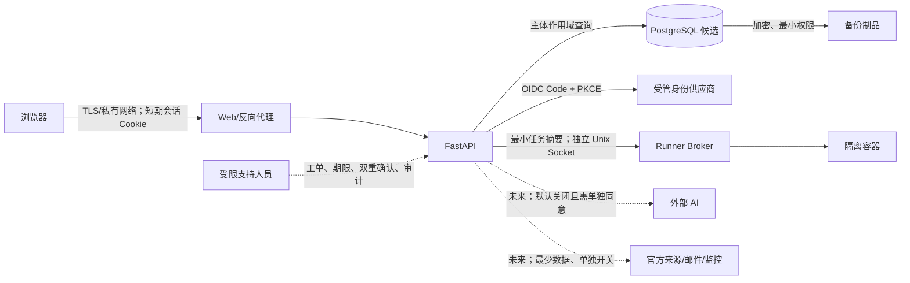

# 第九里程碑 9A：决策包、数据清单与威胁建模

> 文档版本：`9a.2`
>
> 状态：M9-D01–D12 已确认，等待项目所有者明确是否授权 9B
>
> 完成日期：2026-09-05（Asia/Shanghai）
> 基线：`main@305986a`

本文是 9A 的只读规划产物。它不修改运行系统，不创建账号、OAuth 应用、数据库、监控、邮件
或云资源，不安装依赖，不迁移真实数据，不访问真实用户，也不授权 9B–9H。所有价格均为
2026-09-04 访问官方页面得到的快照；正式实施前必须重新核价。

## 1. 当前事实、范围与结论

已确认的事实：

- 当前仓库有 47 张 SQLAlchemy 表，运行基线仍是 6D 的单用户私有部署；没有 `users`、
  `user_id` 或 `tenant_id` 主体归属模型。
- 当前认证是单一 Tailscale/Microsoft 所有者校验；Tailscale 所有者身份头不能直接扩展成通用
  用户数据库。
- 当前数据库实现是 SQLite；备份、远程 Runner、外部 AI、真实来源和邮件仍受现有开关与门禁
  约束。
- `algorithm@0.3.0` 仍为 `draft + intake: closed`，默认入口仍为 `0.2.2`；9A 不改变它。
- 工作区在 9A 开始前已有未提交的 `AGENTS.md`、`README.md`、`TODO.md`、
  `docs/project-status.md` 改动；本阶段只在相关文档中追加状态和产物，不覆盖这些改动。

9A 的工作结论：

1. 多用户候选必须以稳定内部主体为中心，外部身份只作为可撤换的 `(issuer, subject)` 凭据。
2. 9B 前不应批量给现有 47 张表增加字段；先确认地区、身份、数据库、隐私主体、保留、支持
   和预算决定。
3. 推荐架构方向是“受管 OIDC/OAuth + PostgreSQL 候选数据层 + 受限角色 + 邀请制”，但这
   仍是建议，不是已经选择的供应商或托管方式。
4. 9G 前必须保持合成身份/合成数据；真实身份、个人数据、真实邮件和新的付费能力均须重新
   单独授权。

## 2. M9-D01–D12 决策登记

“推荐”不等于“已确认”。只有项目所有者逐项确认或修改后，9A 才能通过决策门禁。

| 编号 | 待确认事项 | 9A 推荐 | 当前状态与后续影响 |
| --- | --- | --- | --- |
| M9-D01 | 首批用户与规模 | 邀请制固定小批量；人数上限由 9F 容量证据决定 | 已按推荐确认；具体人数待 9F 证据，不得现在猜测 |
| M9-D02 | 地区、语言、年龄 | 首批仅成年人、中文；若接收中国大陆用户，先完成新加坡数据跨境专业复核 | 已按推荐确认边界；专业复核仍是 9D/9G 前置门禁 |
| M9-D03 | 身份供应商 | Clerk；通过受管 OIDC/OAuth 接入，不自建密码库 | 已确认；项目所有者于 2026-09-05 选择 Clerk。具体套餐、数据位置、MFA、导出和退出验证仍是 9C/9F 门禁，不构成采购授权 |
| M9-D04 | 数据库与托管方式 | 9B 在隔离候选环境使用自管 PostgreSQL 和合成数据；不修改 6D 真实 SQLite；9F 根据容量、备份和恢复证据再决定独立自管或托管方案 | 已确认；项目所有者于 2026-09-05 接受分阶段方案。任何服务器、托管数据库或付费资源仍须另行授权 |
| M9-D05 | 角色模型 | 仅 `user`、`owner_operator`、`support_restricted`；不做团队、组织、自定义角色 | 已按推荐确认 |
| M9-D06 | 注册与邀请 | 一次性、单用途、有期限、可撤销邀请；不开放注册、搜索或用户枚举 | 已按推荐确认 |
| M9-D07 | 功能范围 | AI、真实来源、邮件默认关闭；Runner 使用每用户/全局配额并有全局急停 | 已按推荐确认 |
| M9-D08 | 数据控制者与隐私联系 | 当前由“云奕学项目所有者（joonas-001）”以个人身份作为临时数据控制者；9G 前建立专用支持/隐私邮箱；公开 GitHub Issue 只处理不含个人信息的功能与缺陷 | 已确认；账号恢复、隐私删除和安全报告不得进入公开 Issue。具体邮箱创建及专业复核仍是 9G 前置门禁，不公开个人住址或私人联系方式 |
| M9-D09 | 保留与删除 | 学习等业务数据在账号有效期保留；最终删除确认后等待 7 天，期间只允许撤销或导出；会话/凭据立即撤销，等待期结束后清除主库正文；支持记录 90 天，最小无敏感安全墓碑 180 天，临时队列 30 天，运维日志 7 天；备份沿用 7 个日备份/4 个周备份并自然过期，恢复后重新应用删除墓碑 | 已确认；项目所有者于 2026-09-05 按建议确认。专业复核可以要求缩短或依法调整期限，但不得静默延长或恢复已删除账号 |
| M9-D10 | 支持承诺 | 中国时间工作日 10:00–18:00（法定节假日除外）；普通功能/账号问题 2 个工作日内首次响应，隐私/删除/安全报告 1 个工作日内首次响应；发现跨用户泄露、账号接管或删除失效时立即暂停新增邀请及相关能力；计划维护尽量提前 24 小时通知，紧急维护尽快通知；非工作时间只接收，不承诺即时处理；不宣传 24/7、SLA 或确定修复时间 | 已确认；项目所有者于 2026-09-05 按建议确认。9G 前使用专用非公开邮箱，公开 GitHub Issue 仅处理不敏感问题 |
| M9-D11 | 多用户预算 | 月度预期不超过 ¥300，硬上限 ¥500；累计 ¥250/¥400 分别触发 50%/80% 告警，达到 ¥500 停止新增付费调用和邀请；Clerk 最多预留 ¥200/月，现有腾讯云按月均 ¥30 计入，监控与备份合计不超过 ¥50/月；9B PostgreSQL、Runner 仅用现有/隔离容量且不新增现金费用，邮件、真实 AI、真实来源预算均为 ¥0；未用额度不得自动挪用 | 已确认；项目所有者于 2026-09-05 按建议确认。禁止自动充值/扩容；任何新增订阅、服务器、托管数据库、年付套餐或无法估价项目仍须单独确认；法律/隐私专业审查作为一次性专项报价另行授权 |
| M9-D12 | 内测、阶段 go 与回滚 | 9G 仅固定小批量邀请制成年人；9H `go` 只允许进入第十里程碑，不是公开上线 | 已按推荐确认边界；具体人数待 9F 容量证据 |

## 3. 逐表数据归属清单

以下是从当前 `apps/api/src/cloud_study_api/models.py` 的 47 张表逐一核对的 9A 分类。
“未来归属”是 9B 的设计输入，不是本阶段的数据库改动。

### 3.1 全局受管内容、策略和来源元数据

| 表 | 未来归属 | 数据类别 | 重点限制 |
| --- | --- | --- | --- |
| `app_settings` | 全局受管策略 | 系统开关、超时 | 不能继续作为用户设置；运维审计变更 |
| `skill_version_content_locks` | 全局受管内容 | 技能版本锁摘要 | 不含用户学习正文；版本不可变 |
| `source_check_runs` | 全局来源运营 | 来源检查统计 | 不含用户私有正文；保留最少请求元数据 |
| `source_check_results` | 全局来源运营 | HTTP/来源元数据 | `final_url`、错误信息需防止私有 URL 泄露 |
| `source_change_candidates` | 全局受管内容 | 来源变化候选 | 只记录差异证据；不自动改写课程 |
| `readiness_policy_snapshots` | 全局受管策略 | 规则快照 | 版本化、不可静默覆盖 |
| `experiment_policy_snapshots` | 全局受管策略 | 实验规则快照 | 不代表用户结果 |
| `market_evidence_snapshots` | 全局受管/合成 | 市场快照 | 合成标记必须保留；不得冒充实时结论 |

### 3.2 运维配置、凭据引用和临时队列

| 表 | 未来归属 | 数据类别 | 重点限制 |
| --- | --- | --- | --- |
| `ai_provider_profiles` | 全局运维；未来可关联最小主体 | 供应商、模型、凭据引用 | 只保存不可直接调用的引用；不回显密钥 |
| `notification_preferences` | 用户私有设置；全局默认另行保存 | 邮件偏好、收件地址、SMTP 元数据 | 地址与凭据引用属敏感个人数据；不能保留单例 |
| `email_outbox` | 对应用户通知的临时数据 | 邮件队列、错误 | 默认关闭；不得记录正文或密钥；按状态短期清理 |
| `notifications` | 用户私有通知 | 标题、消息、关联 ID、已读状态 | 列表和 dedup 必须按主体隔离 |
| `runner_invocations` | 用户私有运行审计 | 任务摘要、状态、结果摘要 | 不记录源代码/完整输入；按主体、任务和运行时隔离 |
| `market_research_synthesis_attempts` | 用户关联的受限临时记录 | 调用、成本、响应摘要 | AI 关闭；保留审计必要字段，不保存多余响应正文 |

### 3.3 诊断、规划、学习和证据：用户私有

| 表 | 未来归属 | 数据类别 | 重点限制 |
| --- | --- | --- | --- |
| `diagnostic_sessions` | 用户私有 | 诊断会话、模型锁和同意 | 同一主体作用域；模型/供应商不可中途切换 |
| `diagnostic_answers` | 用户私有 | 回答文本 | 敏感自由文本；导出/删除/日志最小化 |
| `diagnostic_events` | 用户私有审计 | 诊断事件 | 事件载荷禁止秘密和无关正文 |
| `planning_proposals` | 用户私有 | 计划草稿/快照 | 精确技能版本锁定；历史不可静默改写 |
| `planning_units` | 用户私有 | 计划单元 | 随提案归属；删除随主体策略处理 |
| `planning_unit_sources` | 用户私有关联 | 单元来源引用 | 仅引用 ID，不复制来源全文 |
| `planning_change_events` | 用户私有审计 | 计划变更 | 追加式、不可静默删除 |
| `learning_runs` | 用户私有 | 学习执行及状态 | 必须显式携带主体；终态历史保留 |
| `learning_run_locks` | 用户私有 | 执行版本锁 | 绑定不可变技能/规划版本 |
| `learning_unit_instances` | 用户私有 | 单元快照和状态 | 与 `learning_runs` 强归属 |
| `learning_activities` | 用户私有 | 学习活动 | 不能跨主体复用执行状态 |
| `activity_attempts` | 用户私有 | 提交、纠错链 | 自由文本/代码按敏感数据处理 |
| `activity_evaluations` | 用户私有 | 结构化评估结果 | 不把结果外推为整门掌握 |
| `mastery_evidence` | 用户私有证据 | 能力范围证据 | 证据等级、范围、时效必须独立保留 |
| `mastery_snapshots` | 用户私有证据 | 六维快照 | 待办标记不能覆盖原证据 |
| `review_tasks` | 用户私有 | 延迟复习任务 | 到期与完成状态不可跨主体读取 |
| `learning_events` | 用户私有审计 | 学习事件 | 追加式；不写正文和密钥 |
| `learning_independent_reviews` | 用户私有证据 | 真人评审记录 | 只记录关系、范围、量表、结论、日期；不收身份证明 |

### 3.4 目标、准备度、市场和实验：用户私有

| 表 | 未来归属 | 数据类别 | 重点限制 |
| --- | --- | --- | --- |
| `user_goal_selections` | 用户私有 | 当前目标、技能范围 | 不能默认推断为变现目标 |
| `readiness_evaluations` | 用户私有证据 | 准备度评估 | 必须绑定用户目标、技能版本和证据快照 |
| `path_comparisons` | 用户私有 | 路径比较 | 合成市场数据要显式标记 |
| `path_comparison_decisions` | 用户私有审计 | 用户决定及理由 | 不自动执行外部动作 |
| `readiness_events` | 用户私有审计 | 准备度事件 | 追加式、范围化 |
| `market_research_runs` | 用户私有 | 市场研究调用和成本 | 外部 AI 默认关闭；按主体计费和限额 |
| `market_research_events` | 用户私有审计 | 市场研究事件 | 不记录密钥和无关请求正文 |
| `monetization_experiments` | 用户私有 | 实验计划和证据 | 首版只保留就业通用契约，外部动作必须用户手动确认 |
| `experiment_independent_reviews` | 用户私有证据 | 真人评审 | 绑定精确能力范围和量表版本 |
| `experiment_action_records` | 用户私有 | 用户手动作记录 | 产品不自动投递/联系/发布 |
| `experiment_outcomes` | 用户私有 | 实验结果 | 不反推掌握或保证收入 |
| `experiment_income_records` | 用户私有敏感 | 收入记录索引 | 金额默认隐藏；不保存附件 |
| `experiment_income_revisions` | 用户私有敏感 | 追加式收入修订 | 删除时清敏感值、保留审计墓碑 |
| `experiment_feedback_suggestions` | 用户私有 | 回流建议 | 只作建议，不自动改计划 |
| `experiment_events` | 用户私有审计 | 实验事件 | 追加式、按主体隔离 |

清单结论：当前没有可以安全地声明为“共享用户数据”的业务表。9B 必须为用户私有表补齐
稳定主体归属；全局表必须通过服务边界禁止被错误复制为用户数据；新增支持、安全和账号审计
表也必须从第一天携带主体、操作者、理由、范围和期限。

## 4. 数据流与信任边界

主要信任边界：

- 浏览器是不可信客户端；任何 `user_id`、对象 ID、角色和导出范围都不能信任前端传入。
- OIDC 只证明外部主体，API 必须严格校验 issuer、audience、nonce、state、PKCE 和账号状态。
- Web/API 与数据库之间必须存在服务层主体作用域，数据库侧还应有纵深防御；缓存、错误响应、
  列表、搜索和导出都属于授权边界。
- Runner 只能收到有范围、可审计、限资源的任务；不能访问数据库、凭据、Docker Socket、
  宿主仓库或用户任意路径。
- 备份是高权限数据副本；删除传播、自然过期、恢复后的已删除账号状态都必须可验证。
- 支持人员不是用户代理；临时支持访问不得无条件读取正文、冒充用户或直接改库。
- 外部 AI、来源、邮件和监控是独立外发边界，默认关闭，不能因认证上线自动开启。

## 5. STRIDE/LINDDUN 风险登记

| ID | 风险 | 影响 | 9B–9F 必须证明的控制 | 当前残余状态 |
| --- | --- | --- | --- | --- |
| R-01 | 伪造身份头/信任代理头 | 冒充其他主体 | 仅信任受控代理；生产拒绝缺失/伪造身份；反例测试 | 当前单用户边界不能外推 |
| R-02 | OIDC issuer/audience 混淆 | 绑定错误账号 | 精确 issuer/audience/nonce/state/PKCE；禁止自动合并 | 未实施 |
| R-03 | 会话固定、重放、未撤销 | 账号接管 | 登录轮换、短期/绝对过期、服务端撤销、全设备退出 | 未实施 |
| R-04 | 邀请令牌泄露或重复使用 | 未授权注册 | 只存哈希、单用途、期限、撤销、URL/日志脱敏 | 未实施 |
| R-05 | IDOR/列表/搜索枚举 | 跨用户读取 | 默认拒绝、主体过滤、统一不可枚举 403/404 语义、并发测试 | 当前业务无主体模型 |
| R-06 | 导出范围扩大 | 批量隐私泄露 | 导出由服务端主体推导；版本、摘要、范围和审计；A/B 交叉测试 | 未实施 |
| R-07 | 缓存/错误/通知串读 | 间接泄露 | 主体维度缓存键、错误脱敏、通知按主体去重和读取 | 未实施 |
| R-08 | 支持越权或冒充用户 | 高敏正文/账号被改 | 工单、最小范围、期限、双确认、用户可见、不可变审计 | 支持工具尚不存在 |
| R-09 | 删除不完整/备份复活 | 持续保留或重新可用 | 撤销会话/凭据、正文清除、墓碑、备份过期、恢复回归 | 未实施 |
| R-10 | 账号恢复绕过删除/停用 | 已删除账号复活 | 状态机、身份绑定审计、恢复反例和所有者锁定手册 | 未实施 |
| R-11 | Runner 横向访问或资源耗尽 | 代码执行/服务中断 | 非 root、断网、只读根、资源上限、按主体配额、急停、清理 | 4B/6D 基础设施证据不能替代多用户证据 |
| R-12 | 日志含正文、代码、token、邮箱 | 二次泄露 | 允许列表日志、不可逆主体 ID、密钥扫描、日志抽样审查 | 未实施 |
| R-13 | 外部 AI/邮件/来源过度外发 | 隐私与费用失控 | 最小数据、独立同意/开关、单次和全局预算、硬停止 | 当前默认关闭 |
| R-14 | 并发竞态绕过配额/状态 | 重放、重复扣费、越权写入 | 幂等键、事务约束、锁、并发矩阵和失败回滚 | 未实施 |
| R-15 | 角色提升/错误运维权限 | 全站数据暴露 | 三角色固定矩阵、默认拒绝、管理操作再认证和审计 | 未实施 |
| R-16 | 数据位置/跨境告知不实 | 法律、信任和停服风险 | 运营主体、地区允许列表、专业审查、供应商位置和退出路径 | D02/D08 已确认边界；专业复核、Clerk 数据位置和具体联系地址仍是 9G 门禁 |
| R-17 | 依赖/镜像/供应商供应链 | 代码或数据被篡改 | 锁版本、来源、SBOM/扫描、撤回和回滚；不安装新依赖 | 9A 不实施 |
| R-18 | 价格、免费额度或欠费变化 | 服务中断/不可估价 | 预算预留、告警、硬停止、无自动充值、月度复核 | D11 未确认 |

LINDDUN 补充关注：可链接性（主体 ID 与日志）、可识别性（邮箱/身份）、不可否认性（审计）、
可检测性（访问/删除/支持操作）、信息泄露（导出/备份/错误）、内容不可知性（最小收集）和
合规不知情（告知/同意/跨境）。它们必须在 9D/9E 形成可执行流程，不能仅写免责声明。

## 6. 角色与授权矩阵草案

| 能力 | `user` | `owner_operator` | `support_restricted` |
| --- | --- | --- | --- |
| 读取/修改自己的学习、目标、证据 | 仅本人 | 仅在明确运维范围内 | 默认拒绝 |
| 读取/修改其他用户对象 | 拒绝 | 按工单和最小范围；默认不读正文 | 拒绝 |
| 查看系统健康/配额/成本聚合 | 仅用户可见摘要 | 可见运维聚合 | 仅必要摘要 |
| 创建/撤销邀请 | 拒绝 | 允许；需审计和限额 | 拒绝 |
| 停用/恢复账号 | 仅申请删除/恢复自己的状态 | 允许；高风险再认证 | 只能提交请求 |
| 全局急停 Runner/AI/来源/邮件 | 拒绝 | 允许；不可变审计 | 可建议，不可执行 |
| 支持临时访问 | 不适用 | 批准并双重确认 | 仅在期限/范围内；不可导出 |
| 读取密钥原文、Docker、数据库 | 拒绝 | 也不得经产品界面读取 | 永远拒绝 |
| 导出/删除用户数据 | 导出或删除本人 | 仅执行受管作业，不得任意导出 | 拒绝 |

任何未列出的操作默认拒绝。`owner_operator` 不是读取所有正文的永久豁免；产品所有者的
运维需要也必须留下理由、范围和审计。

## 7. PostgreSQL/备份迁移草案（仅 9B 输入）

1. 在隔离合成环境建立 `users`、外部身份映射、账号状态、邀请、会话/撤销和角色表；内部 ID
   使用随机不可推导标识，邮箱不作主键。
2. 为所有用户私有业务对象增加非空主体归属、外键、组合唯一约束和索引；全局受管表保持与
   用户主体分离。
3. 先建立合成 owner 和 A/B 用户，迁移前冻结源库写入；记录源/目标摘要、行数、外键、事件
   顺序、内容锁和敏感字段计数，不记录正文到报告。
4. 在候选 PostgreSQL 完成导入、应用读写、备份恢复和跨用户拒绝矩阵；失败时销毁候选，
   原 SQLite 不覆盖、不降级、不改变 6D 真实库。
5. 进行反向回退演练：恢复到迁移前快照，验证已删除、审计墓碑、技能版本锁、学习历史和
   证据范围不被抬高；重复执行必须幂等或明确拒绝。
6. 只有 9B 单独授权后，才允许产生迁移代码/迁移文件；只有另行授权后才可评估真实库。

## 8. 官方价格与退出成本快照

这些数字只用于形成候选区间，不构成采购授权，也不能直接相加为最终预算。美元价格不换算
成人民币，以免把汇率、税费和地区费率伪装成确定成本。

| 类别/候选 | 官方快照 | 数据位置、锁定与退出注意 |
| --- | --- | --- |
| Auth0 B2C | Free $0，最多 25,000 MAU；Essentials $35/月、最多 500 MAU；Professional $240/月、最多 500 MAU。页面比较中 MFA factors 在 Free/Essentials 未包含、Professional 包含 | 需另核数据地区、跨境、MFA 和导出条款；OIDC 迁出要保留主体映射和回滚 |
| Clerk | Hobby $0，单应用最多 50,000 MRU；Pro $25/月月付或 $20/月年付；Pro 包含 MFA；超额 MRU $0.02 起；SMS 美国/加拿大 $0.01/条，国际价按市场 | MRU 与 MAU 不同；需另核数据地区、导出和恢复；年付会增加退出/退款约束 |
| Supabase（含 PostgreSQL） | Free $0，50,000 MAU、500 MB 数据库、5 GB 出站；Pro 起 $25/月，100,000 MAU、8 GB 磁盘、250 GB 出站、每日备份 7 天；付费首个 Micro 计算 $10/月且有 $10 计算抵扣 | 这是托管平台组合而非裸 PostgreSQL；地区、额外计算、备份/PITR、出站、暂停和迁出必须另核 |
| 同机自管 PostgreSQL | 本次无新增供应商标价；复用现有单实例只代表“增量现金成本未核定为 0” | 与 Web/API 同故障域；需要自行承担升级、容量、备份、恢复、监控和退出；不得直接据此放行真实用户 |
| Amazon SES | 官方页面当前 Essentials 0–10M 邮件为 $0.16/1,000；Pro 为 $0.22/1,000 且 $105/账户/区域/月；页面另列按量 outbound $0.10/1,000 的价格路径 | 费率/计划正在变化；还需核发信、地区、IP、退信、数据位置和停用路径；9A 不启用邮件 |
| Sentry | Developer $0，限 1 用户；Team $26/月（年付展示），含 50,000 errors 等额度；Business $80/月（年付展示） | 监控会接触错误上下文；必须脱敏、核地区、保留、导出和欠费行为；不能把免费计划当多用户支持方案 |
| Backblaze B2 | 起价 $6.95/TB/月；首 10 GB 存储免费；平均存储量 3 倍以内出站免费，超出 $0.01/GB | 需核区域、加密密钥控制、删除传播、恢复时间、API 费和迁出；价格页不是完整备份方案 |
| Cloudflare R2 | Standard $0.015/GB-month；Class A $4.50/百万请求，Class B $0.36/百万；每月 10 GB、100 万 A、1,000 万 B 免费；互联网出站免费 | 需核账户/区域可用性、保留/删除、密钥和迁出；免费额度不可替代硬预算 |
| Tailscale | Personal $0，最多 6 用户但页面限定非商业个人使用；Standard $8/用户/月；Premium $18/用户/月；超出 50 个 tagged resources 后 $1/个/月 | 现有私有访问不等于应用身份；需核商业/内测适用性、用户席位和退出；不能把所有者身份头复用为用户库 |
| Runner、AI、官方来源 | Runner 当前固定实例/锁定镜像的增量成本尚未拆分；5B 的 DeepSeek 费用政策和硬上限继续有效；真实 AI/来源在 9A 关闭 | 必须在 9F 用容量/成本矩阵测量；无法估价即停止，不自动切换或充值 |

官方来源：

- [Auth0 Pricing](https://auth0.com/pricing)
- [Clerk Pricing](https://clerk.com/pricing)
- [Supabase Pricing](https://supabase.com/pricing)
- [Amazon SES Pricing](https://aws.amazon.com/ses/pricing/)
- [Sentry Pricing](https://sentry.io/pricing/)
- [Backblaze B2 Pricing](https://www.backblaze.com/cloud-storage/pricing)
- [Cloudflare R2 Pricing](https://developers.cloudflare.com/r2/pricing/)
- [Tailscale Pricing](https://tailscale.com/pricing)

未完成核验的成本项：腾讯云当前实例的多用户容量边界、PostgreSQL 独立实例/托管地区价、
供应商税费和汇率、MFA/短信国际价、事务邮件发信资质、专业法律/隐私审查、支持工时、
数据导出和退出迁移工时。这些不能用记忆或免费额度填补。

## 9. 后续门禁与测试矩阵输入

| 阶段 | 9A 已定义的最低证据 |
| --- | --- |
| 9B | A/B/暂停/删除/owner 合成主体；每个业务对象主体归属；跨用户 URL/列表/搜索/导出/通知/Runner/错误均拒绝；PostgreSQL 合成迁移、回退、备份恢复 |
| 9C | OIDC issuer/audience/nonce/state/PKCE；会话固定/过期/撤销/并发退出；邀请重放/枚举；账号停用/删除/恢复；MFA 和测试凭据不落地 |
| 9D | 版本化告知/同意；访问、更正、全量导出、删除；关闭外发后的限制展示；备份恢复不复活已删除账号 |
| 9E | 支持最小字段、临时授权、到期撤销、不可变审计；每用户/全局配额；急停；安全/隐私/滥用分流；价格和容量硬停止 |
| 9F | 跨用户隔离、认证反例、迁移/回滚、隐私、支持、容量、费用、备份、浏览器/E2E、无障碍和完整 `release-readiness`；无严重/高风险未关闭问题 |

## 10. 9A 结论与 9B 授权边界

项目所有者于 2026-09-04 回复“按推荐”，确认了 D01、D02、D05、D06、D07、D12 的推荐边界，
并确认 D03/D04/D09/D10/D11 的原则部分；2026-09-05 进一步选择 Clerk 作为身份供应商。9A 的
事实盘点、逐表归属、数据流、风险、角色矩阵、迁移草案和官方成本快照已形成；项目所有者同日
确认 D04 的分阶段 PostgreSQL 方案，并按建议确认 D08 的临时个人数据控制者和专用联系渠道
边界，并按建议确认 D09 的分级保留与删除期限、D10 的支持承诺和 D11 的月度 ¥300 预期、
¥500 硬上限。至此 M9-D01–D12 全部确认；逐表归属不存在“未知”，价格来源可复核，本阶段
没有付费、远程写操作、供应商接入、依赖安装、云资源创建或真实数据处理。

项目所有者于 2026-09-05 随后明确“授权9B”，因此 9A 阶段关闭。9B 的授权只覆盖合成身份、
合成数据、隔离自管 PostgreSQL 候选和本地代码/验证；不包含 Clerk SDK/应用、真实身份、
真实数据库、云端变更、邀请或付费资源。9B 实施证据见 `milestone-9b-validation.md`。
